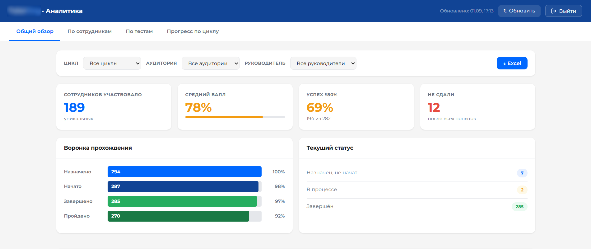
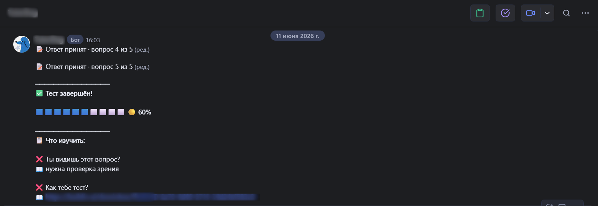

# Assessment Bot & Admin Dashboard

A monthly certification system for 200 employees: a corporate-messenger bot runs assessments in parallel across all teams, with a FastAPI admin dashboard for managing tests, roles, and results.

Built solo. Replaced a manual process where assessments ran twice a year and each cycle occupied three trainers for two months at ~80% of their workload. Now: monthly certification with near-zero trainer involvement, a 6x increase in assessment frequency. About 860K RUB a year saved (10 person-months of manual work).




## Why this exists

Certification used to be a live, one-on-one process: 30-45 minutes per employee with a trainer present. At 200 employees, a full cycle physically required months of calendar time and most of three trainers' capacity, so it ran only twice a year, and skill gaps stayed invisible for six months at a time.

The bottleneck wasn't test content. It was seriality: one trainer, one employee, one time slot. The fix was to make assessment parallel and self-serve, the bot delivers tests to everyone simultaneously, enforces timing and retry rules, collects results centrally, and the dashboard gives trainers and team leads a live view instead of manual spreadsheets.

## What's in this repo

```
n8n/            4 production workflows (JSON exports) + extracted node logic
  wf1_*.json      test distribution
  wf2_*.json      answer processing
  wf3_*.json      reminders
  wf4_*.json      retry / second attempt
  *.js            Code-node logic extracted into standalone modules
  *.test.js       unit tests for that logic
dashboard/      FastAPI app: main.py, access.py (role-based auth), UI
tests/          Python tests: auth, scopes, access cache
tools/          resume_stuck.py, recovery utility for interrupted assessments
.github/        CI deploy workflow
```

Secrets, service accounts, and data are excluded by design, see "Running this" below.

## Stack & key decisions

- **n8n for orchestration.** Assessment workflows change monthly (new tests, new team configurations). Visual workflows mean a non-developer, a trainer, can trace the logic and adjust schedules without touching code, so the system doesn't depend on my availability. In practice this cut both ways: the same UI-editability let production drift ahead of git, see "What I'd do differently".
- **Code-node logic extracted into testable modules.** n8n Code-nodes are convenient but untestable in place, so their logic lives in standalone `.js` files with unit tests (question sampling, multi-correct answers, start validation, data preparation) and is mirrored into the workflows. This is also my general rule for AI-assisted development: I own the architecture, reviews, tests and deployment, and delegate routine generation; anything generated gets isolated into a unit-testable module before it ships.
- **FastAPI dashboard with role-based access.** Three scope levels: admins (trainers and the HR department head) see everything; division heads see all teams in their division (implementation, support, etc.); team leads see their own team only. Employees don't use the dashboard at all, their entire interface is the bot. Scopes are enforced server-side (`access.py`) with an access cache; covered by dedicated tests (auth, scopes, cache invalidation).
- **Data layer: Google Sheets -> Supabase (Postgres).** The first version deliberately stored tests and results in Google Sheets so that trainers could author and edit content with zero custom tooling. At 200 users running assessments in parallel, the Sheets API quota (60 requests/minute) became a hard ceiling; I made the case for migration with load data and moved storage fully to self-hosted Supabase (Postgres). Sheets were retired entirely; test content is currently updated through database migrations, an authoring UI for trainers is the known trade-off of that decision and the next planned step.
- **Redis for in-flight assessment state.** Each user's progress through a running test (current question, answers so far, timing) lives in Redis, separate from Postgres: fast per-message reads/writes during an assessment, durable results written to Postgres on completion. This split is also what makes interrupted assessments recoverable (`tools/resume_stuck.py`), the in-flight state survives workflow restarts.
- **Failure recovery.** Assessments interrupted mid-run (messenger hiccups, restarts) resume from their Redis state via `tools/resume_stuck.py` instead of the user starting over or a trainer intervening.
- **CI deploy** via GitHub Actions to a corporate server, where services run as isolated Docker containers. The deploy SSH key carries a forced command, it can do exactly one thing; the deploy script health-checks the service and halts with logs on failure.

## Results

- Assessment frequency: 2×/year -> monthly (6×).
- Trainer time per cycle: three trainers × 2 months at ~80% load -> near zero.
- About 860K RUB a year saved (10 person-months of manual work).

## What I'd do differently

- Start with Postgres and a thin editing UI instead of using Google Sheets as a database. Sheets bought authoring simplicity for non-technical staff, but at 200 parallel users the API quota (60 req/min) became a hard ceiling and forced a mid-flight storage migration. The lesson: "simple for editors" and "the storage layer" are two different problems, solving both with one tool coupled them.
- Pair the migration with an admin panel from day one. Retiring Sheets fixed the load problem but regressed authoring: test content is now updated through database migrations, i.e. through me, recreating exactly the kind of person-dependency this system was built to remove. Next step is a CRUD layer over the same Postgres, most likely off-the-shelf (NocoDB gives trainers a spreadsheet-like UI they already know; Directus/Baserow are the same class) rather than hand-rolled.
- Treat n8n as transport, not as the application. Logic accreted inside workflow JSON (~1,000 lines across Code nodes, answer-checking duplicated in four places, 123 `$('Node name')` references that break silently on rename); UI edits let production drift ahead of git; deploys were a manual ritual with no staging; and a community node sits in the critical path, unpinned, with unverified webhook signature validation. What n8n genuinely provides, cron, retries, execution history, has cheap equivalents in the stack already running on the same host (systemd timers / pg_cron, a FastAPI webhook route, an events table). The path I'd take: first compress each workflow to trigger -> HTTP call -> done (WF2: 43 nodes -> ~4), moving all logic into git under tests and CI. After that, dropping n8n entirely becomes a one-evening, fully reversible decision instead of a rewrite, and while it stays, its retries and execution history come free.

## Running this

This repository is a portfolio snapshot of an internal production system. It is not runnable outside the corporate environment: secrets, service accounts, messenger credentials, and data stores are excluded by design. The workflows, extracted logic, tests, and dashboard code are provided to show structure and engineering decisions, not as a deployable product.
